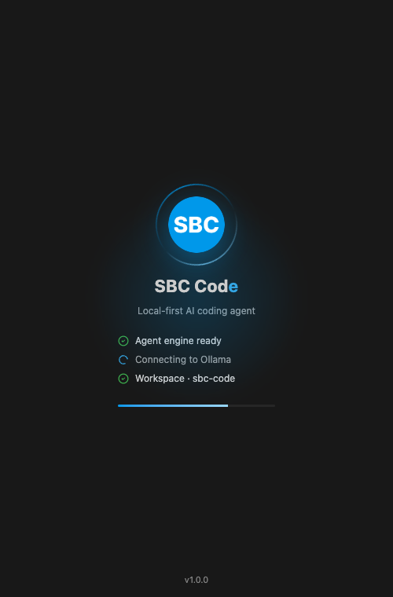
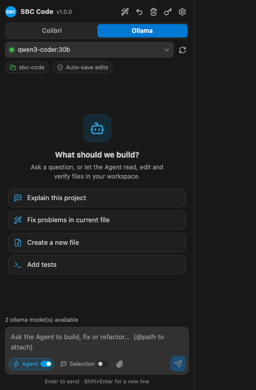
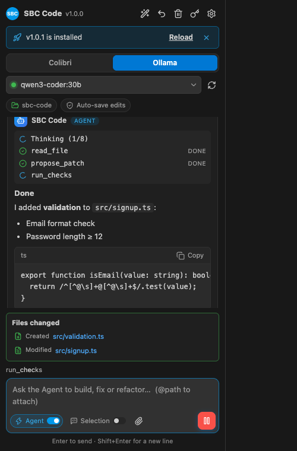
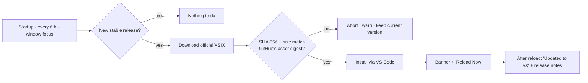
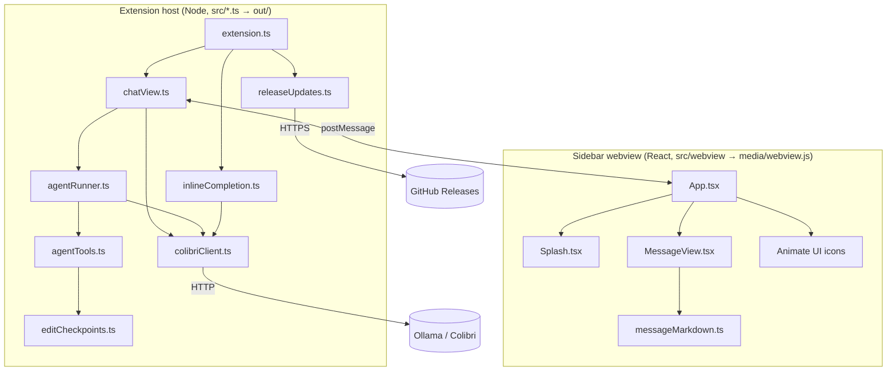

<div align="center">


# SBC Code

### The local-first AI coding agent for Visual Studio Code

**Chat with your code. Let the Agent read, create and fix files. See exactly what was saved.**

Run on your own models with **Ollama**, **Colibri** or any OpenAI-compatible server. Your code goes only to the endpoint you choose, and SBC Code keeps itself up to date with verified releases.

[](https://github.com/sbc-apps/sbc-code/actions/workflows/ci.yml)
[](https://github.com/sbc-apps/sbc-code/releases/latest)


[**Download latest**](https://github.com/sbc-apps/sbc-code/releases/latest/download/sbc-code.vsix) ·
[**Quick start**](#-quick-start) ·
[**Features**](#-features) ·
[**Automatic updates**](#-automatic-updates) ·
[**Configuration**](#%EF%B8%8F-configuration) ·
[**Development**](#-development)

</div>

<table>
  <tr>
    <td align="center" width="33%"><br><sub><b>Animated splash</b> · live startup checks</sub></td>
    <td align="center" width="33%"><br><sub><b>Sidebar</b> · provider, model, workspace</sub></td>
    <td align="center" width="33%"><br><sub><b>Agent</b> · activity, receipts, updates</sub></td>
  </tr>
</table>

---

> [!NOTE]
> **v1.0.0.** Results depend on the model you choose. Use a coding model with **tool calling** for multi-step Agent work. Smaller models work well for chat and single-file generation. Keep your projects under Git.

## ✨ Why SBC Code

| | |
| --- | --- |
| 🔒 **You own the inference** | Ollama, Colibri or any OpenAI-compatible endpoint. Localhost by default; remote HTTP is blocked unless you allow it. |
| 🛠️ **Real workspace actions** | The Agent lists, searches and reads files, checks VS Code Problems, makes exact patches and creates files, all inside one trusted folder. |
| ✅ **Verified results** | Each Agent run ends with a **Created / Modified** receipt built from what was actually saved to disk, not from what the model claims. |
| ↩️ **Safe to experiment** | Every AI edit is checkpointed. Restore the last one with conflict detection, or switch to diff review for each change. |
| ⚡ **Fast** | Batched streaming, debounced and cached inline suggestions, and a splash that closes as soon as your server answers. |
| 🔄 **Always current** | New stable releases are downloaded, checked against their SHA-256 and installed automatically. You only reload. |

## 🚀 Quick start

### 1. Install

SBC Code is distributed through [GitHub Releases](https://github.com/sbc-apps/sbc-code/releases). This link always points to the **latest** version:

**[⬇ Download sbc-code.vsix (latest)](https://github.com/sbc-apps/sbc-code/releases/latest/download/sbc-code.vsix)**

In VS Code, open **Extensions → … → Install from VSIX…**, select the downloaded file and reload.

Or install the latest release from a terminal:

```bash
# macOS / Linux
curl -fL -o /tmp/sbc-code.vsix https://github.com/sbc-apps/sbc-code/releases/latest/download/sbc-code.vsix
code --install-extension /tmp/sbc-code.vsix
```

```powershell
# Windows (PowerShell)
Invoke-WebRequest https://github.com/sbc-apps/sbc-code/releases/latest/download/sbc-code.vsix -OutFile "$env:TEMP\sbc-code.vsix"
code --install-extension "$env:TEMP\sbc-code.vsix"
```

Each release also carries the versioned `sbc-code-X.Y.Z.vsix` and its `.sha256` checksum if you want to pin or verify a specific version. You install once. After that, SBC Code [updates itself](#-automatic-updates) from the latest GitHub Release.

### 2. Start a model server

<details open>
<summary><b>Ollama</b> (recommended for most machines)</summary>

```bash
ollama pull qwen3-coder     # or any model that fits your hardware
ollama serve                # skip if Ollama already runs as a service
```

SBC Code discovers installed models via `GET /api/tags`, and uses `/v1/chat/completions` for chat, streaming and tools.

</details>

<details>
<summary><b>Colibri</b> or another OpenAI-compatible server</summary>

```bash
git clone https://github.com/JustVugg/colibri.git
cd colibri && ./start-here.sh
```

The default endpoint is `http://127.0.0.1:8000/v1`; change it with `sbcCode.baseUrl`. If your server needs a key, run **SBC Code: Set API Key**. The key is stored in VS Code SecretStorage and is never sent to Ollama.

</details>

### 3. Open a folder and go

1. **File → Open Folder…** and trust the folder (the Agent works in one trusted local folder).
2. Click the **SBC** icon in the Activity Bar. The splash screen checks the engine, your provider and your workspace.
3. Pick **Colibri** or **Ollama**, choose a model, and ask:

```text
Create a responsive landing page in index.html with a pricing section.
```

```text
Read the current Problems in src/app.ts and fix them with minimal changes.
```

```text
Find the main untested module in this workspace and add focused unit tests.
```

## 🧩 Features

### Sidebar

- **Animated interface** built with [Animate UI](https://animate-ui.com) and [Motion](https://motion.dev). Icons animate on hover, and it follows your VS Code theme (light, dark or high contrast) and the system *reduce motion* setting.
- **Splash screen** shows live startup checks (engine, provider with model count, workspace). It closes as soon as the server responds, and you can skip it with a click, Enter or Esc, or turn it off with `sbcCode.showSplash`.
- **Provider switch and model picker** with a live connection indicator (green online, amber connecting, red offline).
- **Rich replies:** headings, lists, inline code, and code blocks with a copy button. Model output is always rendered as text, never as HTML.
- **Agent activity timeline** shows every tool call as it runs, finishes, fails or is declined.
- **Clickable file receipts** open the files the Agent created or modified.
- **Composer** with Agent and Selection toggles, up to three attached files, `@file(path)` mentions, Enter to send, and Stop to cancel.

### Agent tools

| Tool | What it does |
| --- | --- |
| `list_files` | Find files in the workspace (secrets and build output are excluded) |
| `search_workspace` | Literal text search with matching line snippets |
| `read_file` | Read a whole file, or a 1-based line window of a large one |
| `get_diagnostics` | Read current VS Code Problems (TypeScript, ESLint, …) |
| `propose_patch` | Exact, unique, non-overlapping find/replace edits in files already read |
| `propose_edits` | Create new files, or replace a file that was fully read |
| `run_checks` | Run an allowlisted test/lint/build command, **only after you confirm** |

The Agent is bounded so it stays predictable. It takes up to **`sbcCode.agentMaxSteps` model steps** (default 8, max 25) with three tool calls per step. Each edit covers up to four files and eight patches per file. File reads are capped at 512 KiB per file and 18,000 characters per window. If a small model emits code instead of tool calls, an explicit single-file request (such as *"create index.html"*) is still saved through the same guarded write path.

### Editor commands

| Command | Where |
| --- | --- |
| **SBC Code: Explain Selection** | Editor context menu |
| **SBC Code: Edit Selection** | Editor context menu (saved automatically or reviewed, per edit policy) |
| **SBC Code: Fix Current File Diagnostics** | Editor context menu, sidebar ✨ button |
| **SBC Code: Restore Last AI Edit** | Sidebar ↩ button, Command Palette |
| **SBC Code: Select Model / Refresh Models** | Sidebar, Command Palette |
| **SBC Code: Set API Key** | Sidebar 🔑 button, Command Palette |
| **SBC Code: Check for Updates** | Sidebar title bar, Command Palette |

### Inline suggestions (optional)

Enable `sbcCode.inlineSuggestions` for ghost-text completions. Requests wait for a short typing pause (≈280 ms), and a newer keystroke cancels the request in flight. Recent results are cached, so moving the cursor back and forth costs nothing. It is off by default because CPU-only inference can be slow.

### Edit policy and recovery

| `sbcCode.agentEditMode` | Behaviour |
| --- | --- |
| `automatic` *(default)* | Edits are applied, saved and read back from disk to verify them |
| `review` | Each edit opens a VS Code diff and waits for **Approve File** |

Neither mode runs terminal commands silently. Every AI edit is checkpointed for the session (the last five batches). **Restore Last AI Edit** previews the restore and refuses to overwrite changes you made later. Checkpoints are not backups; use Git.

## 🔄 Automatic updates

SBC Code updates itself from **official GitHub Releases**:



- **Silent and verified.** Background updates show only a small status-bar indicator. The VSIX must be the exact official asset (`sbc-code-X.Y.Z.vsix` on `github.com/sbc-apps/sbc-code`), and its size and SHA-256 must match GitHub's published digest, or nothing is installed.
- **Efficient.** Lookups use ETags, so an unchanged release returns `304 Not Modified` and does not count against GitHub's rate limit. Checks are shared across all your VS Code windows (at most hourly at startup), and the release is installed once, not once per window.
- **Resilient.** If the computer slept, the next window focus triggers a check. Offline checks fail silently. A failed background install offers **Retry**.
- **Tidy.** Older downloaded VSIX files are deleted after an update.
- **Stable only.** Drafts and pre-releases are ignored, and versions never go backwards.

Choose the behaviour with `sbcCode.autoUpdate`:

| Value | Behaviour |
| --- | --- |
| `install` *(default)* | Download, verify and install automatically, then offer to reload |
| `notify` | Only show a notification with **Install Update / View Release / Later** |
| `off` | Never check automatically. **SBC Code: Check for Updates** still works |

Update checks contact `api.github.com` and GitHub's download CDN. No source code, prompts or telemetry are sent.

## ⚙️ Configuration

Open **Settings → Extensions → SBC Code**, or click the ⚙ button in the sidebar.

| Setting | Default | Description |
| --- | --- | --- |
| `sbcCode.provider` | `colibri` | Default provider; the sidebar switch remembers your choice |
| `sbcCode.ollamaBaseUrl` | `http://127.0.0.1:11434` | Ollama server origin |
| `sbcCode.ollamaModel` | *empty* | Fixed Ollama model (otherwise use the sidebar picker) |
| `sbcCode.baseUrl` | `http://127.0.0.1:8000/v1` | Colibri / OpenAI-compatible API base |
| `sbcCode.model` | *empty* | Fixed Colibri model ID |
| `sbcCode.agentEditMode` | `automatic` | `automatic` or `review` |
| `sbcCode.agentMaxSteps` | `8` | Model steps per Agent request (1–25); lower is faster on CPUs |
| `sbcCode.maxTokens` | `2048` | Maximum output tokens per request |
| `sbcCode.temperature` | `0.2` | Sampling temperature |
| `sbcCode.maxContextChars` | `12000` | Maximum characters of an attached editor selection |
| `sbcCode.inlineSuggestions` | `false` | Experimental ghost-text completions |
| `sbcCode.autoUpdate` | `install` | `install`, `notify` or `off` |
| `sbcCode.showSplash` | `true` | Animated splash while the sidebar connects |
| `sbcCode.allowInsecureRemote` | `false` | Allow plain HTTP to non-local servers (not recommended) |
| `sbcCode.updateNotifications` | `true` | *Deprecated*: `false` still disables checks when `autoUpdate` is unset |

<details>
<summary>Example: fully local Ollama setup</summary>

```json
{
  "sbcCode.provider": "ollama",
  "sbcCode.ollamaBaseUrl": "http://127.0.0.1:11434",
  "sbcCode.ollamaModel": "qwen3-coder:latest",
  "sbcCode.agentEditMode": "automatic",
  "sbcCode.agentMaxSteps": 8,
  "sbcCode.autoUpdate": "install"
}
```

</details>

## 🔐 Privacy and security

- **You choose where inference runs.** Localhost is the default. With a remote endpoint, the prompts and the file content the Agent reads are sent to that endpoint, and unencrypted remote HTTP is refused unless you allow it.
- **Workspace boundary.** Tools work only inside one trusted local folder. They reject secret files (`.env*`, keys, certificates), paths outside the workspace, and symlinks that escape it.
- **Constrained execution.** Only allowlisted check commands are available, and each one asks you first. Remember that approved project scripts run real code.
- **Hardened webview.** It uses a strict Content Security Policy (nonce-only scripts, no inline styles or remote resources), and model output is never parsed as HTML.
- **Secrets.** API keys live in VS Code SecretStorage and are never forwarded to Ollama.
- **No telemetry.** The only network traffic besides your model server is the GitHub update check.

Always review and test AI-generated changes before shipping them.

## 🩺 Troubleshooting

| Symptom | Fix |
| --- | --- |
| Red dot / *Server offline* | Start Ollama or Colibri, check the URL setting, then press ↻ |
| No models in the picker | `ollama pull <model>` (or load a model in Colibri), then ↻ |
| *No files created or modified* | Turn **Agent** on, open a trusted folder, and use a tool-calling coding model |
| Agent stops before finishing | Split the task, or raise `sbcCode.agentMaxSteps` |
| No inline suggestions | Enable `sbcCode.inlineSuggestions` and select a model; CPU models are slow |
| Update not installing | Run **SBC Code: Check for Updates**, check `sbcCode.autoUpdate` and internet access |
| Splash feels unnecessary | Set `sbcCode.showSplash` to `false` |
| A restore is refused | The file changed after the AI edit; recover with Git |

Please report bugs in [Issues](https://github.com/sbc-apps/sbc-code/issues) with your extension version, provider, model and steps to reproduce. **Never paste API keys or private source into public issues.**

## 🧑‍💻 Development

**Requirements:** Node.js 20+, VS Code 1.90+.

```bash
git clone https://github.com/sbc-apps/sbc-code.git
cd sbc-code
npm ci             # dependencies are pinned in package-lock.json
npm run check      # type-check the extension host and the webview
npm test           # build + 60+ unit and HTTP integration tests
npm run package    # produce sbc-code-X.Y.Z.vsix
```

Press **F5** to start an Extension Development Host. While working on the sidebar, run `npm run watch:webview` for incremental bundles with source maps.

### Architecture



| Path | Purpose |
| --- | --- |
| `src/extension.ts` | Activation, commands, wiring |
| `src/chatView.ts` | Webview host, chat/agent orchestration, batched streaming |
| `src/agentRunner.ts`, `src/agentTools.ts` | Agent loop and guarded workspace tools |
| `src/colibriClient.ts`, `src/modelProviders.ts` | OpenAI-compatible and Ollama transport |
| `src/releaseUpdates.ts`, `src/updatePolicy.ts`, `src/releaseMetadata.ts` | Verified automatic updates |
| `src/webview/` | React UI, splash and vendored Animate UI icons (bundled by esbuild) |
| `src/messageMarkdown.ts` | Safe Markdown subset shared by the UI and its tests |
| `scripts/build-webview.mjs` | esbuild bundle → `media/webview.js` |
| `scripts/publish-release.mjs` | CI release publisher (VSIX + SHA-256) |

### Smoke test against a real Colibri server

```bash
COLIBRI_BASE_URL=http://127.0.0.1:8000/v1 npm run smoke:colibri
npm run smoke:colibri -- --tools
```

### Releasing

1. Bump `version` in `package.json` and add a `CHANGELOG.md` entry.
2. Merge to `main`. [CI](.github/workflows/ci.yml) type-checks, tests and packages on SBC self-hosted runners (fork PRs never run there).
3. The [Release workflow](.github/workflows/release.yml) publishes `vX.Y.Z` with `sbc-code-X.Y.Z.vsix`, its `.sha256`, and a `sbc-code.vsix` copy behind the permanent *latest* download link. Existing releases are never overwritten, and stale commits are skipped.
4. Installed copies pick up the release automatically.

## 📜 License and credits

The package manifest is marked `UNLICENSED`. Public source visibility does not by itself grant a reuse or redistribution license.

The sidebar bundles [Animate UI](https://animate-ui.com) (MIT + Commons Clause), [Motion](https://motion.dev) and [React](https://react.dev) (MIT), and Lucide-derived icon artwork (ISC). See [THIRD_PARTY_NOTICES.md](THIRD_PARTY_NOTICES.md).

---

<div align="center">

**SBC Code: built for developers who want control over where their AI runs.**

Designed & built by **[SBC](https://sbc.om/)**

[Releases](https://github.com/sbc-apps/sbc-code/releases) · [Issues](https://github.com/sbc-apps/sbc-code/issues) · [Changelog](CHANGELOG.md)

</div>
